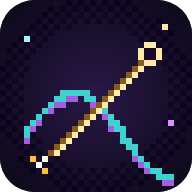
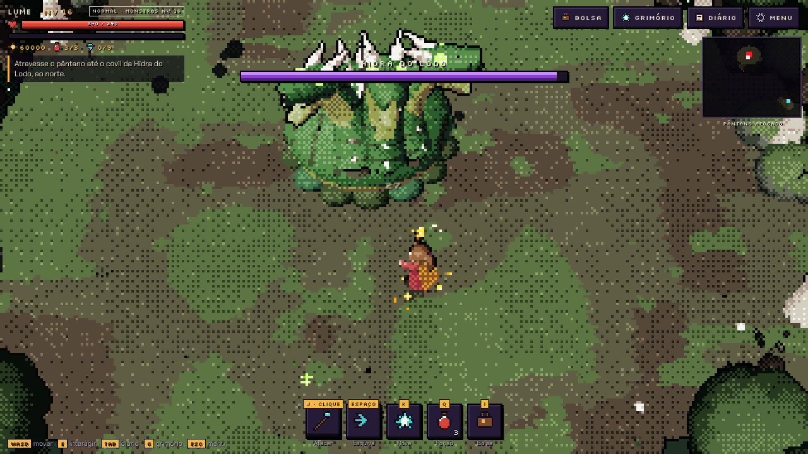
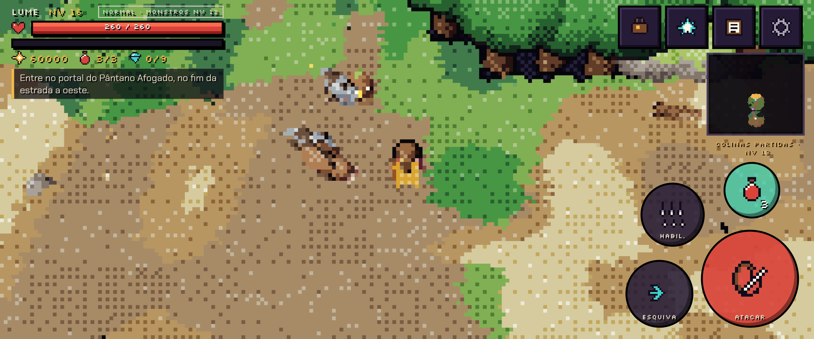
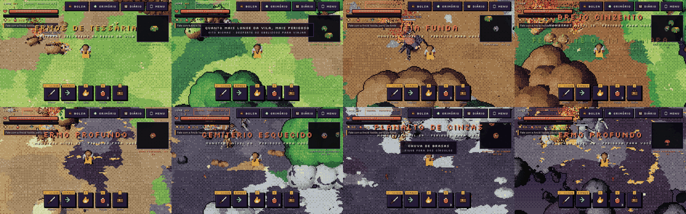
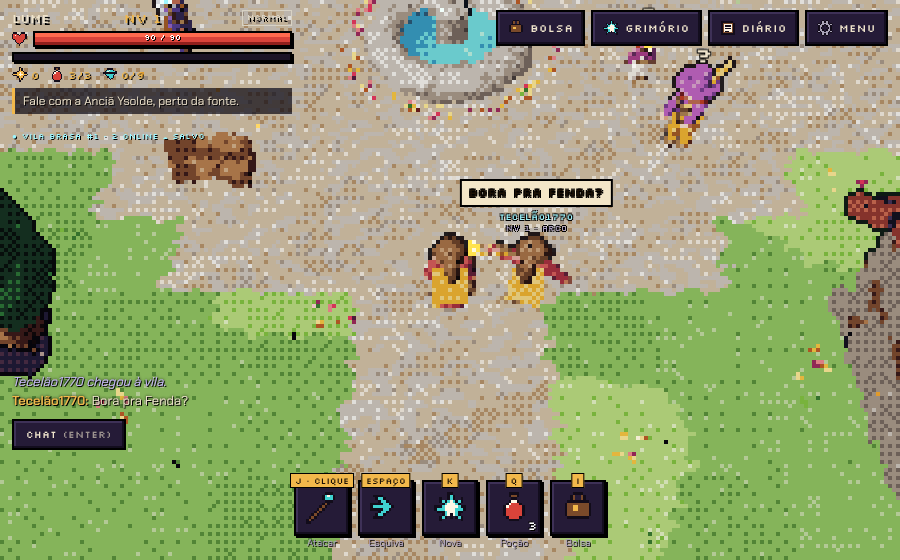
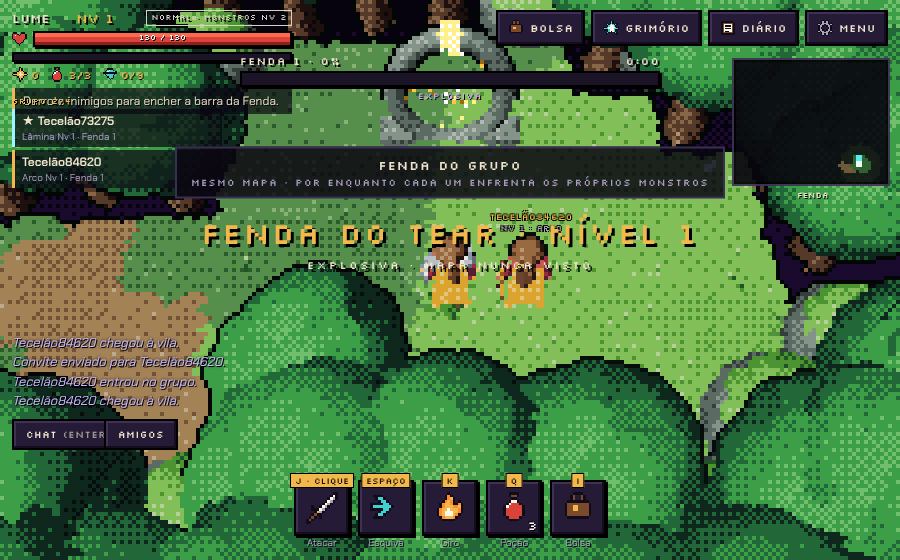

<div align="center">



# Fios de Tessária

**RPG de ação em pixel art 3D, feito inteiro de splats.**
Crie seu Tecelão, explore Tessária e recosture o Sol, um fio de cada vez.

[](https://github.com/RParagon/tessaria/actions/workflows/ci.yml)
[](https://github.com/RParagon/tessaria/actions/workflows/android.yml)




</div>

---

## O jogo

O Sol se apagou e Tessária está se desfazendo em pixels soltos. Você nasceu com uma agulha de luz na mão, a marca dos Tecelões, e é a única pessoa capaz de costurar o mundo de volta.

- **Três classes com identidade própria:** Lâmina (corpo a corpo, mais dano e mais risco), Arcano (o mais seguro, raios que explodem em área) e Arco (flechas que atravessam, forte contra grupos). O equilíbrio é medido em simulação a cada mudança.
- **Criação de personagem** com corpo, pele, cabelo, barba, roupa, acessórios e capa. A armadura e a arma equipadas aparecem no visual.
- **HUD com retrato e ícones 3D:** o seu herói aparece no canto do HUD e os ícones são modelos desenhados pelo motor do jogo; itens de missão têm feixe de luz e uma seta no chão aponta para o mais perto.
- **Herói em destaque:** esqueleto com cotovelos e joelhos (o Arcano segura o cajado com a mão fechada), superfície lisa em alta definição, rosto chibi com olhos escuros, íris colorida e brilho, sobrancelhas e sorriso, cabelo em mechas, roupa com gola, punhos e botas, e capa que esvoaça ao correr. Espelho na bolsa e na criação em alta definição, com poses e zoom; no jogo, zoom da câmera pela roda do mouse (ou + e −) e um anel que marca o seu herói no grupo.
- **Dois atos de história, com finais diferentes.** Ato I: Bosque Sussurrante, Ossuário Real e Picos de Cinza. Ato II: Pântano Afogado e Cidadela de Vidro, com O Reflexo, uma cópia sombria do seu próprio herói.
- **Ermos de Tessária:** um mapa aberto enorme em volta da vila, com **oito biomas** (da Campina Brasa ao Ermo Profundo, passando pela Teia Funda das aranhas, o Brejo Cinzento, as Colinas Partidas, o Cemitério Esquecido e o Planalto de Cinzas), covis com Alfas nomeados, cavernas, obeliscos de viagem rápida, Lua de Sangue e emboscadas.
- **Fendas do Tear** geradas a cada vez, com mapas novos, afixos e guardiões. É onde o jogo continua sem fim.
- **Progressão estilo ARPG:**
  - sete dificuldades, até Tormento III;
  - loot com raridades e lendários com poderes;
  - runas, talentos e itens aprimorados até +10.
- **Vila Brasa:** o hub, com o Bairro Leste (fogueira com bancos, feira da Dora, a Acendedora Lúcia, patos no lago, o Bardo Tomé e seus rumores, arena com bonecos que mostram o seu dano por segundo e o lago onde o Pescador Ivo ensina a pescar: a missão dele dá a vara) e o **Santuário da Fenda**, uma praça de obsidiana e runas violeta com o portal sombrio da Fenda do Tear.
- **Casa do Tecelão:** baú permanente, mobília com bônus visíveis, o Correio do Tear para trocar itens com amigos e o **Guarda-Roupa**, para mudar o visual quando quiser, escolher o estilo da armadura (clássica, couro, placas, escamas ou tabardo real) e comprar estilos raros (auréola, cartola, óculos, orelhas de elfo, flor, tranças).
- **Online e co-op:** encontre outros Tecelões na vila, forme grupo com até 4 amigos e jogue junto nas Fendas e nos Ermos, com os mesmos monstros para todos, cada um com o próprio loot.
- **Feito para celular:** jogado na horizontal, com controles de toque grandes, mira automática e vibração.

<table>
<tr>
<td></td>
<td></td>
</tr>
<tr>
<td></td>
<td></td>
</tr>
</table>



## Controles

| No PC | No celular | Ação |
|---|---|---|
| WASD ou setas | joystick (lado esquerdo) | mover |
| botão esquerdo do mouse (segure) ou J | botão Atacar | atacar, mirando no mouse |
| **botão direito do mouse** ou K | botão Habil. | habilidade (muda com as runas) |
| Espaço ou Shift | botão Esquiva | esquiva (invulnerável no salto) |
| Q | botão de poção | poção |
| E ou Enter | botão Usar | interagir, falar, costurar o amigo caído |
| I · G · Tab | botões no topo | bolsa · grimório · diário |
| roda do mouse ou + / − | menu → Zoom da câmera | aproximar e afastar a câmera (na bolsa, aproxima o espelho) |
| H · Esc | | mostrar/esconder controles · menu |

## Como o visual é feito

Nada aqui é sprite ou malha 3D tradicional. Cada personagem, árvore e chefe é uma nuvem de **splats** (discos coloridos) gerada por código: elipsoides, tubos, cones e membranas presos a ossos animados. A cena é desenhada numa resolução baixa e passa por uma etapa de pós-processamento com:

- **paleta por região:** 5 tons por material;
- **pontilhado Bayer** 4×4;
- **contorno de 1 pixel;**
- **raio-x** quando o herói fica atrás de árvores e telhados.

O resultado é pixel art com volume e iluminação de verdade, rodando em WebGL2 sem nenhuma biblioteca. A música também é procedural: um sequenciador com escalas e progressões próprias para cada região.

## Rodar localmente

Requer Node 20 ou mais novo.

```bash
npm install
npm run dev        # abre em http://localhost:5173
```

| Comando | O que faz |
|---|---|
| `npm run dev` | Servidor de desenvolvimento com recarga automática |
| `npm run build` | Build de produção em `dist/` |
| `npm run preview` | Serve o build de produção |
| `npm test` | Testes de ponta a ponta (Playwright) contra o build de teste, com o servidor online em memória |
| `npm run test:balance` | Tabela de equilíbrio das classes (simulação) |
| `npm run android:sync` | Build web e sincronização com o projeto Android |
| `npm run android:open` | Abre o projeto no Android Studio |
| `npm run icons` | Regera os ícones (web, PWA e Android) |

Para depurar, abra o jogo com `?debug=1`: isso expõe `window.__T`, o gancho usado pelos testes.

### Com o modo online

Em outro terminal, suba o servidor. Sem `DATABASE_URL`, ele guarda tudo em memória (some ao reiniciar):

```bash
npm run dev:server     # http://localhost:2567
```

Em dev, o jogo já procura o servidor nesse endereço, e o botão **Jogar online** aparece no título. Para usar PostgreSQL local, defina `DATABASE_URL=postgres://...` antes do comando. Para apontar o jogo para outro servidor, abra com `?server=https://...`.

| Comando do online | O que faz |
|---|---|
| `npm run dev:server` | Servidor com recarga automática |
| `npm run test:server` | Testes do servidor (com `TEST_DATABASE_URL`, também contra PostgreSQL) |
| `npm run typecheck` | Checagem de tipos do cliente online, `shared/` e servidor |

## Estrutura

```
src/
  main.js              ponto de entrada (Vite)
  styles/game.css      interface
  net/                 cliente online: API, sincronização, vila, telas e chat (TypeScript)
  game/
    manifest.json      ordem de montagem dos arquivos do jogo
    boot/ engine/      contexto WebGL, matemática, gerador de splats
    data/ content/     paletas, itens, história e diálogos
    render/            shaders, modelos, partículas, poses, render do quadro
    world/             regiões, geração de mapas e construção do mundo
    core/              estado, jogador, inimigos, chefes, progressão, loop
    ui/ input/ audio/  interface, controles, efeitos e música
    net/               jogadores remotos e correio online dentro do jogo
shared/                regras usadas pelo jogo e pelo servidor (itens, save, chat, protocolo)
server/                servidor online: Fastify, WebSocket da vila, PostgreSQL
tests/e2e/             testes de ponta a ponta (Playwright)
tools/                 simulador de equilíbrio, gerador de ícones
android/               projeto Android (Capacitor)
deploy/                nginx, docker-compose e exemplo de .env para a VPS
docs/                  arquitetura, roadmap, monetização, deploy
```

Os detalhes estão em [docs/ARCHITECTURE.md](docs/ARCHITECTURE.md).

## Publicar

- **Web, de graça:** Netlify, configurada por `netlify.toml`.
- **VPS:** Easypanel, com o `Dockerfile` (web, nginx) e o `server/Dockerfile` (servidor online) mais um PostgreSQL. Ou tudo junto com `deploy/docker-compose.yml`.
- **Android:** a cada envio para `main`, o GitHub Actions gera um APK para teste.

Passo a passo em [docs/DEPLOY.md](docs/DEPLOY.md).

## Online e co-op



- **Contas:** e-mail e senha, Google ou convidado (que vira conta depois sem perder nada).
- **Save na nuvem:** continue em outro aparelho. Se dois aparelhos gravarem ao mesmo tempo, o jogo pergunta qual progresso usar.
- **Servidor que confere:** saves impossíveis (itens acima do teto, Centelhas demais para o tempo jogado) são recusados.
- **Vila Brasa online:** até 40 por sala, chat com filtro, emotes, e moradores que andam igual para todos.
- **Amigos e grupo:** pedidos de amizade, lista com quem está online e onde, grupo de até 4 com chat próprio.
- **Correio pelo nome**, sem duplicar itens.

### Jogando junto



- **Fenda do grupo e Ermos do grupo:** o líder abre e todos recebem o aviso **Pronto?**. Quem entra cai no mesmo mapa.
- **Os mesmos monstros para todos:** o jogo do líder comanda os inimigos e o chefe; o golpe de qualquer um vale; os monstros atacam quem estiver mais perto.
- **Mais gente, monstros mais fortes:** vida 1,75× em dupla, até 3,25× com quatro.
- **Caído e Costurar:** quem cai fica 15 segundos no chão; um amigo ao lado costura de volta em 3 segundos. Se o grupo inteiro cai, todos voltam ao início.
- **Loot de cada um, sorteado pelo servidor**, no nível e na sorte de cada jogador. Todo item sorteado fica registrado.
- **Dificuldade do grupo e Fio de Elo:** vale a dificuldade do líder, até onde todos desbloquearam; o amigo de nível baixo sobe para perto do líder, e quem é muito mais forte fica limitado e ganha o bônus de mentor.

As regras completas estão em [docs/ONLINE.md](docs/ONLINE.md), e a ordem do que vem por aí (história em grupo, troca, mercado, guilda, Ermos abertos e PvP) em [docs/ROADMAP.md](docs/ROADMAP.md). O modelo de receita está em [docs/MONETIZATION.md](docs/MONETIZATION.md): passe de batalha e cosméticos, **nunca vantagem paga**.

## Licença

© Fios de Tessária. Todos os direitos reservados. O código não é aberto para redistribuição.
