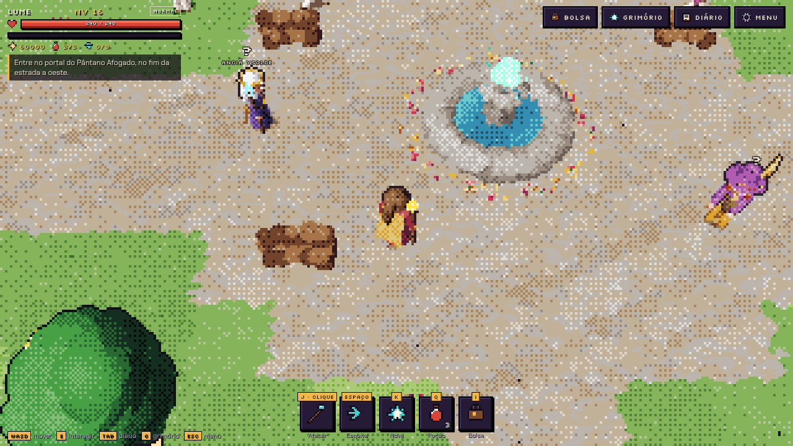
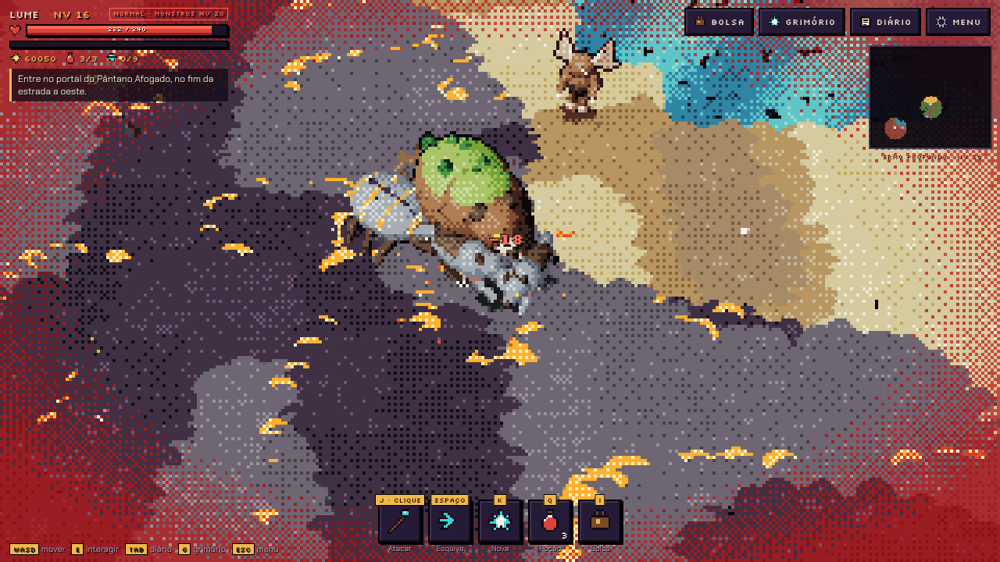
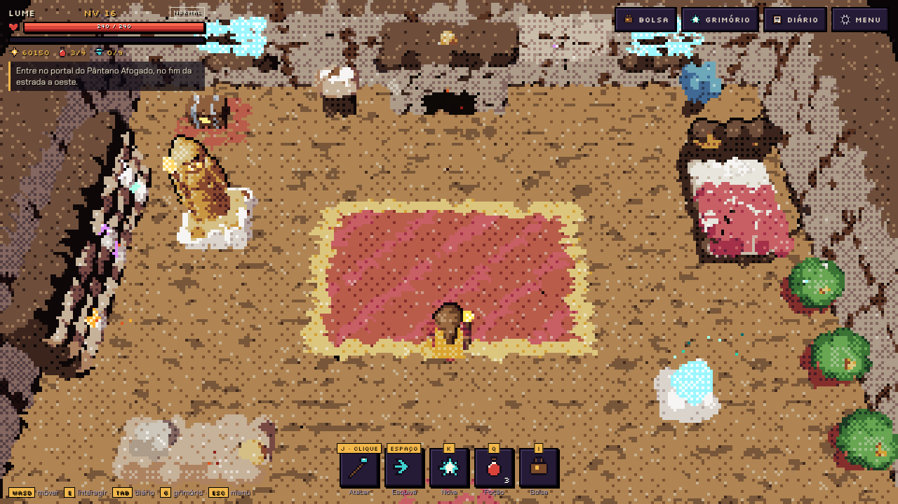

<div align="center">


# Fios de Tessária

**RPG de ação em pixel art 3D, feito inteiro de splats.**
Crie seu Tecelão, explore Tessária e recosture o Sol, um fio de cada vez.

[](https://github.com/RParagon/tessaria/actions/workflows/ci.yml)
[](https://github.com/RParagon/tessaria/actions/workflows/android.yml)


</div>

---

## O jogo

O Sol se apagou e Tessária está se desfazendo em pixels soltos. Você nasceu com uma agulha de luz na mão, a marca dos Tecelões, e é a única pessoa capaz de costurar o mundo de volta.

- **Três classes com identidade própria:** Lâmina (corpo a corpo, mais dano e mais risco), Arcano (o mais seguro, raios que explodem em área) e Arco (flechas que atravessam, forte contra grupos). O equilíbrio é medido em simulação a cada mudança.
- **Criação de personagem** com corpo, pele, cabelo, barba, roupa, acessórios e capa. A armadura e a arma equipadas aparecem no visual.
- **Dois atos de história, com finais diferentes.** Ato I: Bosque Sussurrante, Ossuário Real e Picos de Cinza. Ato II: Pântano Afogado e Cidadela de Vidro, com O Reflexo, uma cópia sombria do seu próprio herói.
- **Ermos de Tessária:** um mapa aberto em volta da vila, com zonas de perigo crescente, animais em matilha, Alfas e acampamentos que renascem.
- **Fendas do Tear** geradas a cada vez, com mapas novos, afixos e guardiões. É onde o jogo continua sem fim.
- **Progressão estilo ARPG:**
  - sete dificuldades, até Tormento III;
  - loot com raridades e lendários com poderes;
  - runas, talentos e itens aprimorados até +10.
- **Casa do Tecelão:** baú permanente, mobília com bônus visíveis e o Correio do Tear, para trocar itens com amigos.
- **Feito para celular:** jogado na horizontal, com controles de toque grandes, mira automática e vibração.

<table>
<tr>
<td></td>
<td></td>
</tr>
<tr>
<td></td>
<td></td>
</tr>
</table>

## Como o visual é feito

Nada aqui é sprite ou malha 3D tradicional. Cada personagem, árvore e chefe é uma nuvem de **splats** (discos coloridos) gerada por código: elipsoides, tubos, cones e membranas presos a ossos animados. A cena é desenhada numa resolução baixa e passa por uma etapa de pós-processamento com:

- **paleta por região:** 5 tons por material;
- **pontilhado Bayer** 4×4;
- **contorno de 1 pixel;**
- **raio-x** quando o herói fica atrás de árvores e telhados.

O resultado é pixel art com volume e iluminação de verdade, rodando em WebGL2 sem nenhuma biblioteca. A música também é procedural: um sequenciador com escalas e progressões próprias para cada região.

## Rodar localmente

Requer Node 20 ou mais novo.

```bash
npm install
npm run dev        # abre em http://localhost:5173
```

| Comando | O que faz |
|---|---|
| `npm run dev` | Servidor de desenvolvimento com recarga automática |
| `npm run build` | Build de produção em `dist/` |
| `npm run preview` | Serve o build de produção |
| `npm test` | Testes de ponta a ponta (Playwright) contra o build de teste |
| `npm run test:balance` | Tabela de equilíbrio das classes (simulação) |
| `npm run android:sync` | Build web e sincronização com o projeto Android |
| `npm run android:open` | Abre o projeto no Android Studio |
| `npm run icons` | Regera os ícones (web, PWA e Android) |

Para depurar, abra o jogo com `?debug=1`: isso expõe `window.__T`, o gancho usado pelos testes.

## Estrutura

```
src/
  main.js              ponto de entrada (Vite)
  styles/game.css      interface
  game/
    manifest.json      ordem de montagem dos arquivos do jogo
    boot/ engine/      contexto WebGL, matemática, gerador de splats
    data/ content/     paletas, itens, história e diálogos
    render/            shaders, modelos, partículas, poses, render do quadro
    world/             regiões, geração de mapas e construção do mundo
    core/              estado, jogador, inimigos, chefes, progressão, loop
    ui/ input/ audio/  interface, controles, efeitos e música
tests/e2e/             testes de ponta a ponta (Playwright)
tools/                 simulador de equilíbrio, gerador de ícones
android/               projeto Android (Capacitor)
deploy/                nginx para a VPS
docs/                  arquitetura, roadmap, monetização, deploy
```

Os detalhes estão em [docs/ARCHITECTURE.md](docs/ARCHITECTURE.md).

## Publicar

- **Web, de graça:** Netlify, configurada por `netlify.toml`.
- **VPS:** Easypanel, com o `Dockerfile` (nginx).
- **Android:** a cada envio para `main`, o GitHub Actions gera um APK para teste.

Passo a passo em [docs/DEPLOY.md](docs/DEPLOY.md).

## Rumo ao online

A versão atual é single-player, com save no aparelho. O plano até o jogo online (vila social, grupos, Ermos compartilhados, zona PvP com perdas maiores e mercado entre jogadores) está em [docs/ROADMAP.md](docs/ROADMAP.md). O modelo de receita está em [docs/MONETIZATION.md](docs/MONETIZATION.md): passe de batalha e cosméticos, **nunca vantagem paga**.

## Licença

© Fios de Tessária. Todos os direitos reservados. O código não é aberto para redistribuição.
